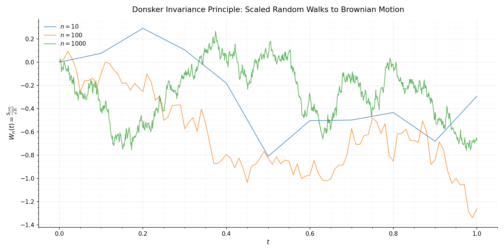
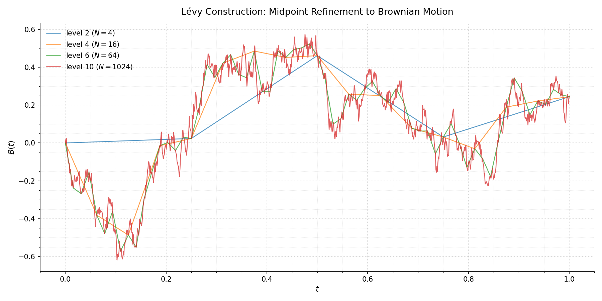
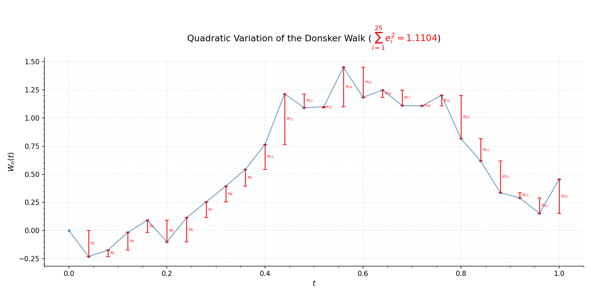

# brownian\_lab

>Three constructions of Brownian motion on [0, 1] in Python (namely Donsker DRRW, Lévy construction \& Cholesky's exact simulation), with plotting and
quadratic-variation visualisation.

This is a companion code to my master's thesis on Stochastic calculus and the Black-Scholes PDE where the rigorous proofs of these constructions (including Functional Central Limit Theorem) that we are coding here can be found. <a href="">[Thesis]</a>

## The three generators

| Function | Construction | Grid |
|---|---|---|
| `donsker_walk(n, seed)` | Diffusively Rescaled Random Walk (FCLT) | n steps |
| `levy(level, seed)` | Lévy midpoint-wriggle construction | 2^level steps |
| `cholesky(n, seed)` | Exact simulation via Cholesky factorization of min(s, t) | n steps |

Each generator returns `(t, W)`, the time grid and the path values. Passing a
list returns a dictionary with one path per entry. Each generator also has `plot_*`, `qv_*` and `plotqv_*` functions, e.g.
`plot_levy`, `qv_levy`, `plotqv_levy`.

## Installation

```
pip install git+https://github.com/kalaapks/brownian_lab.git
```

## Usage
  
```python
from brownian_lab import donsker_walk, plot_donsker, qv_donsker, plotqv_donsker

donsker_walk(100, 43);                 # prints coordinates, returns (t, W)
plot_donsker([10, 100, 1000], 43);     # 3 paths on one plot
qv_donsker([10, 20, 50, 60], 43);      # quadratic variation for each n
plotqv_donsker(20, 43);                # path with increments e_i drawn in red
```

The same pattern works for `levy` and `cholesky`:

```python
from brownian_lab import levy, plot_levy, plotqv_levy

plot_levy([2, 4, 6, 10], 43)          # same seed: each level refines the last
plotqv_levy(4, 43)
```
Note that `plot_*` function is designed to take arrays as input so that we can see the consecutive progression if we want to for the path, we simply need to `plot_levy([1, 2, 3, 4, 5, ...], 42)`


## Plots





## Background

- **Donsker:** the following process is called Diffusively Rescaled Random Walk and it converges in law to Brownian motion. This result is called the Functional Central Limit Theorem.

$$W_n(t) = \frac{S_{\lfloor nt \rfloor}}{\sqrt{n}} \xrightarrow{d} B$$
  
- **Lévy:** the path is built coarse to fine, setting each midpoint to the average of its endpoints plus an independent Gaussian correction:

$$B\left(\tfrac{2k+1}{2^{r+1}}\right) = \tfrac12\left[B\left(\tfrac{k}{2^r}\right) + B\left(\tfrac{k+1}{2^r}\right)\right] + \frac{\epsilon_k}{2^{-(\frac{r}{2}+1)}} \qquad \epsilon_k \sim \mathcal{N}(0,1).$$

- **Cholesky:** $B = LZ$ where $LL^\top = \Sigma$ and $\Sigma_{ij} = \min(t_i, t_j)$. It is exact, but costs $O(n^3)$ to factorise.
- **Quadratic variation:** $\sum_i (\Delta W_i)^2 \to t$ as the grid is refined.

## Status

Generators and plotting are complete. Numerical validation (increment and covariance tests, convergence rates) is in progress.

## Requirements

Python ≥ 3.9, NumPy, SciPy, Matplotlib.

## Attribution

You are welcome to use, modify, and distribute this library under the MIT License.

If you use this project in your own work, attribution to the original repository and its author is appreciated.


